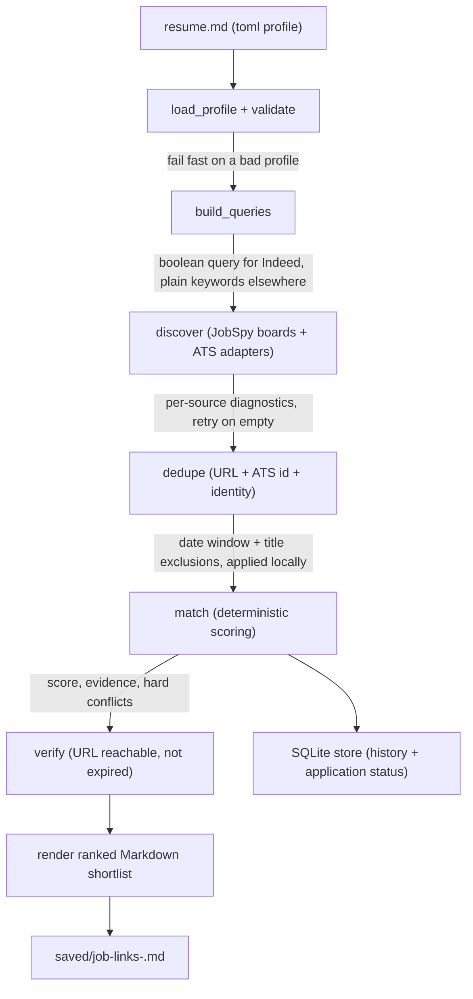

# JobSearch-Pipeline

Job boards are flaky. Each one searches differently, filters differently, and
quietly returns nothing when it's throttling you. This project wraps that
behind one command: read what you want from a profile, ask each board in the
way that board understands, filter once on your machine, and hand you a
markdown list of links — ranked by how well each role matches the résumé.

Scraping is handled by the open-source
[JobSpy](https://github.com/cullenwatson/JobSpy) library (MIT, by Cullen
Watson) for board scraping, and by direct ATS adapters for Greenhouse,
Lever, and Ashby. Everything in this repo that is **not** `jobspy/` is the
layer built on top: profile parsing, query derivation, local filtering,
matching, deduplication, link verification, persistence, and reporting.
`resume.md` and `run.sh` are yours to edit.

## How it works



| Step | What it does | Why |
|---|---|---|
| `load_profile` + `validate` | Extract and type-check the TOML block from `resume.md` | Fail fast with an actionable message |
| `build_queries` | Boolean query for Indeed, plain keywords for every other site | Boards parse queries differently |
| Source adapters | JobSpy boards, plus Greenhouse / Lever / Ashby ATS feeds | ATS feeds give employer-authoritative data without scraping |
| `dedupe` | Match on canonical URL, then on ATS id, then on normalized identity | Tracking redirects and syndicated postings should not double-count |
| `filter_jobs` | Date window, title + stack exclusions, level ceiling, years ceiling — all local | LinkedIn ignores `-X`; Indeed over-applies them |
| `match_job` | Score each job on skills (read from its description), title, seniority, location, employment, experience | One documented formula, applied to every source |
| `verify_url` | Concurrent GETs, SSRF check on every redirect hop, expiry + sign-in-wall detection | Never label an unverified URL as verified |
| `render` | Ranked Markdown shortlist with score, evidence, and verification status | Self-explanatory output for Obsidian or any markdown viewer |
| `store.upsert_jobs` | SQLite-backed history and application status | Track what you have already considered |

## Quick start

```bash
./run.sh                  # discover + rank jobs
./run.sh --dry-run        # print the profile and derived queries, scrape nothing
./run.sh --site indeed,linkedin --results 50
./run.sh search --site greenhouse,lever,ashby
./run.sh list --status new
./run.sh status <job-id> applied
./run.sh inspect          # show the parsed profile as JSON
./run.sh doctors          # run configuration diagnostics
```

`run.sh` bootstraps the virtualenv with `uv` and installs the local package
on first run. After that, every invocation is `python -m jobsearch ...`.

## The profile

`resume.md` contains one fenced `toml` block under `## Job Search Profile`.
**Every setting the pipeline uses comes from that block** (plus the
résumé's own skills section) — nothing about the candidate is hardcoded.
CLI flags only override it for a single run.

```toml
[titles]
primary = "Full-Stack Developer"
also    = ["Full Stack Engineer", "Software Engineer"]

[search]
locations           = ["Bengaluru", "Chennai", "Hyderabad"]   # or one: location = "Bengaluru, India"
country             = "India"
allowed_regions     = ["Karnataka", "KA", "Tamil Nadu", "TN", "Telangana", "Chennai"]
keep_remote         = true            # remote jobs pass the region filter
keep_unknown_location = true          # no location / just the country passes too
sites               = ["linkedin", "indeed", "naukri", "glassdoor", "google"]   # default when --site is omitted
parallel_sources    = 4               # searches run at once
hours_old           = 72
results_per_site    = 30
remote              = "any"           # onsite | remote | hybrid | any
employment_types    = ["full_time"]   # full_time, part_time, contract, internship, temporary
retries             = 1               # retry a site on empty result or error
retry_backoff_seconds = 12
linkedin_fetch_description = true     # slower, but LinkedIn jobs get descriptions

[keywords]
core          = ["Python", "FastAPI", "React", "TypeScript"]   # query terms
exclude       = ["Senior", "Lead", "Principal", "Staff", "Manager"]
exclude_stack = ["Angular", "Java", ".NET"]   # drop titles naming these
level_min     = "junior"   # floor   } off | intern | junior | mid |
level_filter  = "junior"   # ceiling } senior | lead | staff | principal
level_strict  = true       # keep only jobs that show their level (or years) is in band

[skills]
resume_section = "Technical Skills"   # résumé heading the matcher reads; "" = off
also  = ["Postgres", "AWS"]           # extra spellings the résumé evidences
watch = ["Java", "Kubernetes"]        # tech you lack; shown as "missing" when a job asks

[experience]
years              = 0.5
level              = "junior"   # your rung; defaults to level_filter, then years
max_required_years = 2          # drop jobs asking for more

[levels]
aliases = { "specialist" = "senior", "ii" = "junior" }   # or "ignore" to disable a built-in

[verify]
enabled = true
workers = 8
timeout = 8
uncertain_hosts = ["linkedin.com", "indeed.com"]   # never fetched; reported "uncertain"
login_markers   = ["authwall", "login"]
expired_phrases = ["no longer accepting applications"]

[report]
previously_seen = "compact"   # full | compact | hide

[matching]
min_score = 0.0
```

Boards are searched once per entry in `search.locations` (ATS feeds once
in total), so the number of searches is boards × locations. Everything
except `titles.primary`, `search.location`/`locations` and `keywords.core`
is optional; `./run.sh inspect` prints the resolved values and
`./run.sh doctors` points out settings that weaken the results. The full
profile contract is documented at
`.opencode/skills/job-search-profile/SKILL.md`.

## Sources

- **Boards** (via JobSpy): LinkedIn, Indeed, ZipRecruiter, Glassdoor, Google,
  Bayt, Naukri, BDJobs.
- **ATS feeds** (direct, public): Greenhouse, Lever, Ashby. Configure each
  board token via the corresponding environment variable:

  ```bash
  export JOBSEARCH_GREENHOUSE_BOARD=stripe
  export JOBSEARCH_LEVER_BOARD=netflix
  export JOBSEARCH_ASHBY_BOARD=openai
  ```

  Each ATS adapter issues a single GET against the public feed and tolerates
  schema drift. Optional — leave the token unset to disable the source.

ATS adapters never bypass authentication, captchas, or anti-bot systems.
They consume the public, employer-published feeds that each ATS exposes
specifically for this purpose.

## Data and privacy

- The SQLite store lives at `~/.jobsearch/state.db` by default. Override
  with `JOBSEARCH_DB=/path/to/state.db`. Reports land in `saved/`.
- `resume.md` is gitignored. The DB stores **no résumé content** — only the
  normalized job records the pipeline produces.
- The optional LLM provider, when used, would receive job descriptions and
  the candidate's skills. It is not configured by default and is reserved
  for future semantic matching. Add credentials only when you choose to
  enable it.

## Filtering and freshness

Six filters run locally on every job regardless of source:

1. **Date window** — drops jobs posted before `hours_old`. Undated jobs
   are kept and labelled "posted date unknown".
2. **Title exclusions** — `keywords.exclude` drops roles whose title
   contains any excluded token as a whole word.
3. **Stack exclusions** — `keywords.exclude_stack` drops roles whose
   title names a technology you don't work in ("Java" never matches
   "JavaScript").
4. **Level band** — `keywords.level_min` (floor) and
   `keywords.level_filter` (ceiling) drop roles whose level — from the
   title, else the board's level field — falls outside the band. Built-in
   rules cover the usual words plus `Sr`, `Associate`, Indian entry-level
   wording (`Fresher`, `Trainee`, `Graduate` → junior) and numbered
   ladders (`II` → mid, `III` → senior, `IV` → lead); `[levels.aliases]`
   adds, overrides, or (`"ignore"`) removes rules. With
   `keywords.level_strict = true`, roles that state no level are dropped
   too, unless their stated years fit `experience.max_required_years`.
5. **Experience ceiling** — `experience.max_required_years` drops roles
   whose title ("6+ years Mandatory") or description ("3-5 years of
   experience") asks for more. The description reading is lenient: the
   smallest stated requirement counts.
6. **Location** — with `search.allowed_regions` set, roles whose location
   names none of the regions are dropped. Remote roles and roles with no
   location (or just the country) pass unless `keep_remote` /
   `keep_unknown_location` are `false`.

Each job in the report carries a `level: <tier>` line, and the header
shows how many jobs each filter dropped.

## Verification and matching

Each job carries an explicit verification status:

- `verified` — URL resolved, the page corresponds to the vacancy.
- `unverified` — not yet checked (the default for stored jobs).
- `expired` — body text matches one of `verify.expired_phrases`.
- `unreachable` — network failure, HTTP 404/5xx, or a redirect toward a
  private address (refused before it is requested).
- `uncertain` — a board in `verify.uncertain_hosts` (never fetched, since
  they block bots), a redirect to a sign-in page, or HTTP 401/403/429.

HTTP 200 alone is **not** proof that a job is open. A generic employer
career page is **not** a direct application link: the report links the
vacancy itself and shows the employer page separately. Checks run
concurrently (`verify.workers`).

The matching formula is documented in `jobsearch/matching.py`:

- Skill overlap (40%) — the job's required skills are every profile
  vocabulary term (your skills + `skills.watch`) found in its title and
  description; the score is the share you have. Neutral when none appear.
- Title alignment (20%) — substring / token overlap between the job
  title and the candidate's primary + alternative titles.
- Seniority (15%) — `unknown` is neutral; we never penalise the
  candidate for an unstated requirement.
- Location (10%) — preference match against the job's stated work mode.
- Employment type (10%) — intersection with the candidate's acceptable
  types; `unknown` is neutral.
- Experience (5%) — years of experience vs. the job's stated minimum.

Hard conflicts (an on-site-only role when the candidate wants remote, or
an employment type outside `search.employment_types`) short-circuit to
score 0 and are surfaced in the report.

The report lists **new** jobs first; jobs from earlier runs follow as a
compact list (`report.previously_seen`).

## CLI commands

```bash
# Run a search
./run.sh                                       # default sites, default profile
./run.sh search --site indeed,linkedin         # explicit subcommand
./run.sh --dry-run                             # show what *would* be searched

# Inspect, diagnose
./run.sh inspect                               # JSON of the parsed profile
./run.sh doctors                               # configuration warnings

# Persistence
./run.sh list                                  # show new jobs (default)
./run.sh list --status applied                 # show jobs already applied to
./run.sh status <job-id> applied               # mark a job as applied
./run.sh status <job-id> interview --note "phone screen"
```

## Testing

```bash
.venv/bin/pytest tests/ -v
```

The suite is fully deterministic — every adapter, matcher, and storage
call uses fixtures or mocked HTTP. It does not require live job boards,
and every test runs from a temporary working directory so nothing is
written into `saved/`.

## Known limitations

- ATS adapters require a `JOBSEARCH_<NAME>_BOARD` token for each source
  the user wants enabled. The boards listed above are documentation, not
  default values.
- Skill matching is vocabulary-based: a skill neither you nor
  `skills.watch` names is invisible to the score. Grow `skills.watch` as
  you notice gaps in reports.
- Link checks resolve DNS before connecting, so a DNS-rebinding host
  could still answer differently on the second lookup.
- The optional LLM provider is not yet wired to matching; deterministic
  rules handle all current ranking. The profile fields exist so the
  integration can be added without a profile schema change.
- Live board scraping depends on each board's tolerance for automated
  access. Naukri, ZipRecruiter, and Glassdoor are frequently blocked
  from many IPs — failures surface as `SourceDiagnostic.error` in the
  report rather than as silent drops.
- No paid job-board API is required. Optional integrations stay disabled
  when credentials are missing.

## License

Board scraping comes from [JobSpy](https://github.com/cullenwatson/JobSpy)
by Cullen Watson and contributors, MIT licensed. The automation layer in
`jobsearch/` is released under the same MIT license. See `LICENSE`.