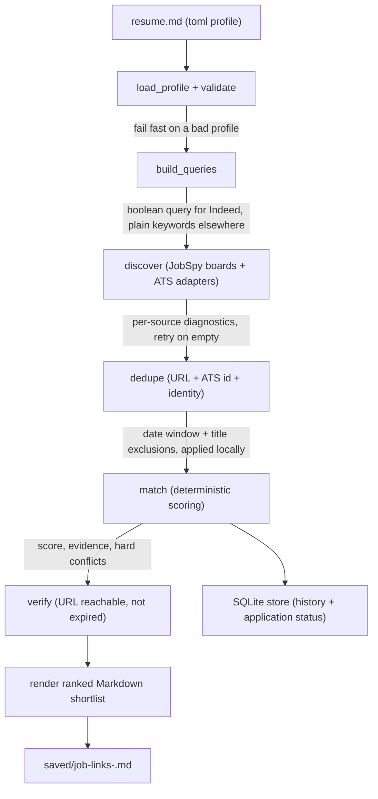

# JobSearch-Pipeline

Job boards are flaky. Each one searches differently, filters differently, and
quietly returns nothing when it's throttling you. This project wraps that
behind one command: read what you want from a profile, ask each board in the
way that board understands, filter once on your machine, and hand you a
markdown list of links — ranked by how well each role matches the résumé.

Scraping is handled by the open-source
[JobSpy](https://github.com/cullenwatson/JobSpy) library (MIT, by Cullen
Watson) for board scraping, and by direct ATS adapters for Greenhouse,
Lever, and Ashby. Everything in this repo that is **not** `jobspy/` is the
layer built on top: profile parsing, query derivation, local filtering,
matching, deduplication, link verification, persistence, and reporting.
`resume.md` and `run.sh` are yours to edit.

## How it works



| Step | What it does | Why |
|---|---|---|
| `load_profile` + `validate` | Extract and type-check the TOML block from `resume.md` | Fail fast with an actionable message |
| `build_queries` | Boolean query for Indeed, plain keywords for every other site | Boards parse queries differently |
| Source adapters | JobSpy boards, plus Greenhouse / Lever / Ashby ATS feeds | ATS feeds give employer-authoritative data without scraping |
| `dedupe` | Match on canonical URL, then on ATS id, then on normalized identity | Tracking redirects and syndicated postings should not double-count |
| `filter_jobs` | Date window + whole-token title exclusions, applied locally | LinkedIn ignores `-X`; Indeed over-applies them |
| `match_job` | Score each job on skills, title, seniority, location, employment, experience | One documented formula, applied to every source |
| `verify_url` | HEAD/GET with SSRF guard, expiration text scan, redirect validation | Never label an unverified URL as verified |
| `render` | Ranked Markdown shortlist with score, evidence, and verification status | Self-explanatory output for Obsidian or any markdown viewer |
| `store.upsert_jobs` | SQLite-backed history and application status | Track what you have already considered |

## Quick start

```bash
./run.sh                  # discover + rank jobs
./run.sh --dry-run        # print the profile and derived queries, scrape nothing
./run.sh --site indeed,linkedin --results 50
./run.sh search --site greenhouse,lever,ashby
./run.sh list --status new
./run.sh status <job-id> applied
./run.sh inspect          # show the parsed profile as JSON
./run.sh doctors          # run configuration diagnostics
```

`run.sh` bootstraps the virtualenv with `uv` and installs the local package
on first run. After that, every invocation is `python -m jobsearch ...`.

## The profile

`resume.md` contains one fenced `toml` block under `## Job Search Profile`:

```toml
[titles]
primary = "GenAI Developer"
also    = ["Generative AI Engineer", "AI Engineer"]

[search]
location            = "Bengaluru, India"
country             = "India"
hours_old           = 72
results_per_site    = 30
remote              = "any"           # onsite | remote | hybrid | any
employment_types    = ["full_time"]   # full_time, part_time, contract, internship, temporary

[keywords]
core    = ["Python", "FastAPI", "LangChain", "RAG", "LLM"]
exclude = ["Senior", "Lead", "Principal", "Staff", "Manager"]

[experience]
years = 4

[matching]
min_score = 0.0

[llm]
provider = ""      # optional, reserved for future LLM-assisted matching
model    = ""
```

The full profile contract is documented at
`.opencode/skills/job-search-profile/SKILL.md`.

## Sources

- **Boards** (via JobSpy): LinkedIn, Indeed, ZipRecruiter, Glassdoor, Google,
  Bayt, Naukri, BDJobs.
- **ATS feeds** (direct, public): Greenhouse, Lever, Ashby. Configure each
  board token via the corresponding environment variable:

  ```bash
  export JOBSEARCH_GREENHOUSE_BOARD=stripe
  export JOBSEARCH_LEVER_BOARD=netflix
  export JOBSEARCH_ASHBY_BOARD=openai
  ```

  Each ATS adapter issues a single GET against the public feed and tolerates
  schema drift. Optional — leave the token unset to disable the source.

ATS adapters never bypass authentication, captchas, or anti-bot systems.
They consume the public, employer-published feeds that each ATS exposes
specifically for this purpose.

## Data and privacy

- The SQLite store lives at `~/.jobsearch/state.db` by default. Override
  with `JOBSEARCH_DB=/path/to/state.db`. Reports land in `saved/`.
- `resume.md` is gitignored. The DB stores **no résumé content** — only the
  normalized job records the pipeline produces.
- The optional LLM provider, when used, would receive job descriptions and
  the candidate's skills. It is not configured by default and is reserved
  for future semantic matching. Add credentials only when you choose to
  enable it.

## Verification and matching

Each job carries an explicit verification status:

- `verified` — URL resolved, the page corresponds to the vacancy.
- `unverified` — not yet checked (the default for stored jobs).
- `expired` — body text indicates the role is closed.
- `unreachable` — network or HTTP failure.
- `uncertain` — reachable but evidence was ambiguous.

HTTP 200 alone is **not** proof that a job is open. A generic employer
career page is **not** a direct application link. The report reflects
that distinction.

The matching formula is documented in `jobsearch/matching.py`:

- Skill overlap (40%) — share of the job's required skills present in the
  candidate's skills. Neutral when the job did not list required skills.
- Title alignment (20%) — substring / token overlap between the job
  title and the candidate's primary + alternative titles.
- Seniority (15%) — `unknown` is neutral; we never penalise the
  candidate for an unstated requirement.
- Location (10%) — preference match against the job's stated work mode.
- Employment type (10%) — intersection with the candidate's acceptable
  types; `unknown` is neutral.
- Experience (5%) — years of experience vs. the job's stated minimum.

Hard conflicts (e.g. on-site-only role when the candidate wants remote)
short-circuit to score 0 and are surfaced in the report.

## CLI commands

```bash
# Run a search
./run.sh                                       # default sites, default profile
./run.sh search --site indeed,linkedin         # explicit subcommand
./run.sh --dry-run                             # show what *would* be searched

# Inspect, diagnose
./run.sh inspect                               # JSON of the parsed profile
./run.sh doctors                               # configuration warnings

# Persistence
./run.sh list                                  # show new jobs (default)
./run.sh list --status applied                 # show jobs already applied to
./run.sh status <job-id> applied               # mark a job as applied
./run.sh status <job-id> interview --note "phone screen"
```

## Testing

```bash
.venv/bin/pytest tests/ -v
```

The suite is fully deterministic — every adapter, matcher, and storage
call uses fixtures or mocked HTTP. It does not require live job boards.

## Known limitations

- ATS adapters require a `JOBSEARCH_<NAME>_BOARD` token for each source
  the user wants enabled. The boards listed above are documentation, not
  default values.
- The optional LLM provider is not yet wired to matching; deterministic
  rules handle all current ranking. The profile fields exist so the
  integration can be added without a profile schema change.
- Live board scraping depends on each board's tolerance for automated
  access. Naukri, ZipRecruiter, and Glassdoor are frequently blocked
  from many IPs — failures surface as `SourceDiagnostic.error` in the
  report rather than as silent drops.
- No paid job-board API is required. Optional integrations stay disabled
  when credentials are missing.

## License

Board scraping comes from [JobSpy](https://github.com/cullenwatson/JobSpy)
by Cullen Watson and contributors, MIT licensed. The automation layer in
`jobsearch/` is released under the same MIT license. See `LICENSE`.